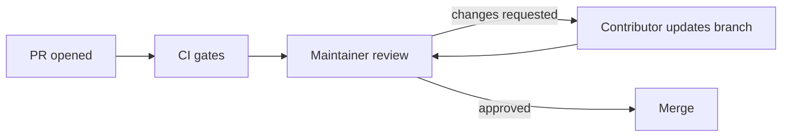

# PACT Code Review & Maintainer SLA Policy

This policy sets expectations for pull request reviews so contributors know what
to expect and reviewers know what to check. It complements
[CONTRIBUTING.md](../CONTRIBUTING.md) (§8–§9, §19) and
[MAINTAINER-WORKFLOW.md](./MAINTAINER-WORKFLOW.md).

---

## 1. Maintainer service-level targets

| PR type | First-response target | Notes |
| --- | --- | --- |
| First-time contributor | **48 hours** | We prioritize newcomers |
| Returning contributor | 72 hours | — |
| Documentation-only / micro-PR | 48 hours | Fast path, light review |
| Security-sensitive | 24 hours | Routed to a security reviewer |

Targets are goals, not guarantees. If a PR is large or spans multiple concerns,
the maintainer may request a split before a full review (see
[CONTRIBUTING.md](../CONTRIBUTING.md) §9).

---

## 2. Review criteria

Every review evaluates the same dimensions:

| Dimension | What reviewers check |
| --- | --- |
| **Scope** | Solves the linked issue only; no unrelated changes |
| **Type safety** | No `any`; explicit domain types; `npx tsc --noEmit` passes |
| **Tests** | New behaviour is covered; `npm test` passes with no regressions |
| **Security** | No service keys or secrets in client code; `node scratch/secret-scan.mjs` is clean |
| **Accessibility** | Keyboard reachable, ARIA correct, WCAG AA contrast for UI changes |
| **Architecture** | Respects server-authoritative boundaries and existing module seams |
| **Documentation** | User-facing or architectural changes update the relevant docs |

---

## 3. Merge requirements

A pull request is merged only when:

- [ ] The linked issue is referenced with `Closes #…` or `Fixes #…`.
- [ ] Continuous Integration passes (see [Testing & Verification Runbook](./TESTING.md)).
- [ ] At least one maintainer approval is present.
- [ ] Review feedback is resolved or explicitly waived.
- [ ] The working tree is clean (no generated files or stray artifacts).

---

## 4. The review loop

Address feedback by pushing more commits to the same branch; the PR updates
automatically. Do not force-push over a reviewer's requested changes without
explanation.

---

## 5. Conflict of interest

Maintainers do not approve their own pull requests. When a maintainer is also
the author, another maintainer reviews. Authors may merge only after the
required approval is present.

---

## 6. Related documentation

- [Contributing Guide](../CONTRIBUTING.md)
- [Maintainer Workflow](./MAINTAINER-WORKFLOW.md)
- [Maintainer Health](./MAINTAINER-HEALTH.md)
- [Git Workflow](./GIT_WORKFLOW.md)
