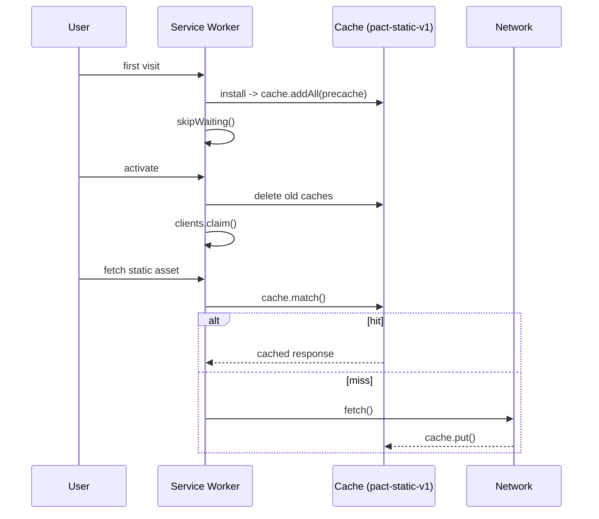
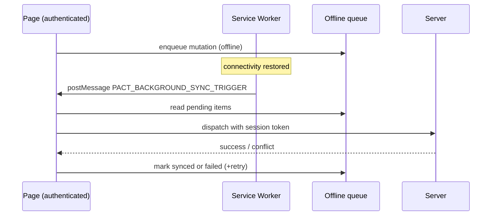

# PWA Offline Caching Architecture

PACT is installable and keeps working when the network drops. This document
describes the service worker, the manifest, and how offline mutations reach the
server. The implementation lives in [`public/sw.js`](../public/sw.js),
[`public/manifest.json`](../public/manifest.json), and
[`src/lib/offline/`](../src/lib/offline/).

---

## 1. Service worker registration

`PwaRegister` (`src/components/pwa/pwa-register.tsx`) registers `/sw.js` with
scope `/`, but only in production:

```ts
if ('serviceWorker' in navigator && process.env.NODE_ENV === 'production') {
  navigator.serviceWorker.register('/sw.js', { scope: '/' });
}
```

`PwaRegister` mounts once in the client app shell. The service worker is
deliberately disabled in development so hot reloads are never served from cache.

---

## 2. Cache strategy

The worker uses a single versioned cache, `pact-static-v1`.

| Request type | Strategy |
| --- | --- |
| Non-`GET` | Passed straight to the network (never intercepted) |
| `/api/`, `*.supabase.co`, `/auth/` | Never cached (privacy boundary) |
| Static assets (`/brand/`, `*.png/jpg/ico/svg/json`, `/_next/static/`) | Cache-first, network fallback |
| HTML navigation (`request.mode === 'navigate'`) | Network-first, offline fallback |

The two guarantees the worker enforces:

1. **Zero private data caching.** Authenticated API responses and Supabase auth
   traffic are never written to a cache, preventing cross-user leakage.
2. **Offline read of the app shell.** Navigation falls back to the cached
   `/app` document, then to an inline "Offline Mode" page.

### Lifecycle



### Precached shell

`STATIC_PRECACHE_URLS` warms the cache on install:

- `/manifest.json`, `/favicon.ico`, `/apple-touch-icon.png`
- `/brand/pact-app-icon-192.png`, `/brand/pact-app-icon-512.png`,
  `/brand/pact-logo-64.png`

---

## 3. Web app manifest

`public/manifest.json` makes PACT installable:

| Field | Value |
| --- | --- |
| `start_url` / `id` | `/app` |
| `scope` | `/` |
| `display` | `standalone` |
| `theme_color` | `#d4af37` |
| `background_color` | `#09090b` |
| Icons | `192x192`, `512x512` (`any maskable`) |

Shortcuts deep-link to **Quick Capture** (`/app?quick=capture`), **Focus Timer**
(`/app/focus`), and **Tasks** (`/app/tasks`).

---

## 4. Offline mutations and the sync queue

When a user acts while offline, the mutation is written to a durable queue
(`pact_offline_sync_queue_v1`). The worker
does not replay mutations itself; instead it wakes the page.

### Background Sync API

On reconnect the browser fires the `sync` event. The worker forwards it to every
open window rather than performing a fetch that might lack auth context:

```js
self.addEventListener('sync', (event) => {
  if (event.tag === 'pact-sync-deltas' || event.tag === 'pact-queue-sync') {
    self.clients.matchAll({ type: 'window' }).then((clients) => {
      for (const client of clients) {
        client.postMessage({ type: 'PACT_BACKGROUND_SYNC_TRIGGER', tag: event.tag });
      }
    });
  }
});
```

The page listens for `PACT_BACKGROUND_SYNC_TRIGGER` and runs its sync engine,
which has the authenticated session. A `message` handler also supports a
`SKIP_WAITING` command so a waiting worker activates immediately.

### Reconnection flow



---

## 5. Contributor checklist

- [ ] Never add authenticated or per-user responses to a cached route.
- [ ] Keep the cache version (`pact-static-v1`) bumped when the strategy changes.
- [ ] Test install/activate cache eviction after a version bump.
- [ ] Verify background sync wakes the page instead of fetching from the worker.

---

## 6. Related documentation

- [Architecture Overview](./ARCHITECTURE.md)
- [Data Model Specification](./DATA_MODEL.md)
- [Security & Zero-Trust Boundaries](./SECURITY.md)
- [Testing & Verification Runbook](./TESTING.md)
