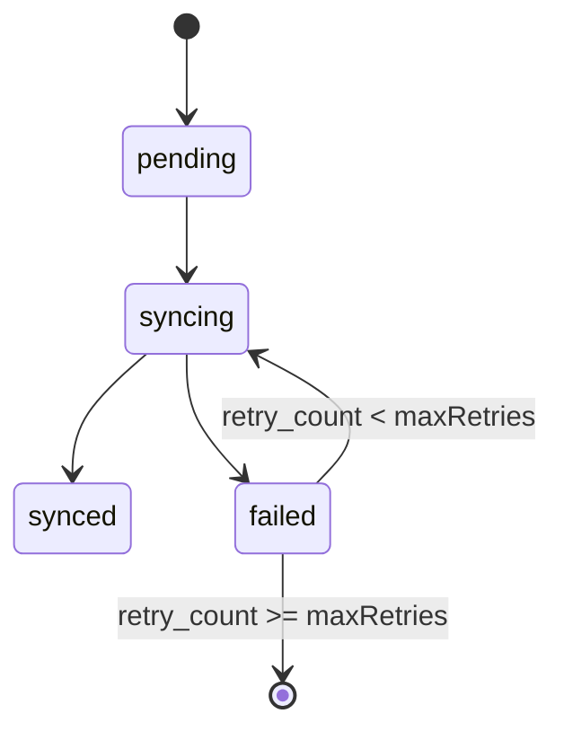
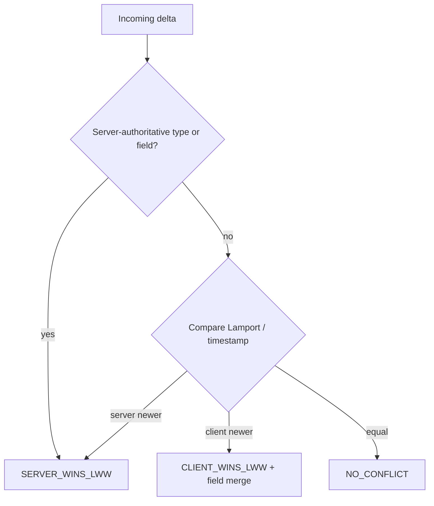

# Offline-First Sync & Conflict Resolution Architecture

PACT treats the client as a cache and the server as the source of truth. This
document describes how offline writes are stored, replayed, ordered, and
reconciled. The implementation lives in [`src/lib/offline/`](../src/lib/offline/).

---

## 1. Storage tiering

Every offline store goes through a small adapter interface
(`getItem` / `setItem` / `removeItem`) so the backing medium is swappable:

```ts
export interface StorageAdapter {
  getItem: (key: string) => string | null;
  setItem: (key: string, value: string) => void;
  removeItem: (key: string) => void;
}
```

Resolution order at module load:

1. **`localStorage`** when a write probe (`__pact_storage_test__`) succeeds.
2. **In-memory `Map`** when `localStorage` is unavailable or throws.
   `IndexedDB`/localStorage/memory tiers are the documented target; the current
   adapter ships `localStorage` with an in-memory fallback, and the seam lets a
   different backend be injected via `setStorageAdapter`.

Private-browsing and quota-exceeded modes fall back to memory automatically.

| Store | Key | Purpose |
| --- | --- | --- |
| Offline queue | `pact_offline_sync_queue_v1` | Pending mutations |
| Entity cache | `pact_local_entity_cache_v2` | Cached server entities (schema v2) |
| Proof attachments | `pact_staged_proof_attachments_v1` | Staged uploads |

---

## 2. The offline queue

Each queued mutation is an `OfflineQueueItem` with a lifecycle status:

```ts
type OfflineItemStatus = 'pending' | 'syncing' | 'synced' | 'failed';
```

An item starts `pending` with `retry_count: 0`. The queue is pure: helpers
return a new array rather than mutating in place.



`getPendingItems` selects items that are `pending`, or `failed` with
`retry_count < maxRetries` (default `3`). `getExhaustedItems` returns
permanently failed items with `retry_count >= maxRetries`.

---

## 3. Background sync engine

`processQueueSync` drains eligible items, dispatching each through an
`OfflineDispatcher` while tracking `succeededCount`, `failedCount`, and
`conflictCount`.

Retries use capped exponential backoff:

```ts
export function calculateBackoffDelay(retryCount: number): number {
  const base = 1000;
  const maxDelay = 30000;
  return Math.min(base * Math.pow(2, Math.max(0, retryCount)), maxDelay);
}
```

| Retry | Delay |
| --- | --- |
| 0 | 1000 ms |
| 1 | 2000 ms |
| 2 | 4000 ms |
| … | capped at 30000 ms |

Reconnection is signalled by the service worker's Background Sync event, which
posts `PACT_BACKGROUND_SYNC_TRIGGER` to open windows; the authenticated page
then runs the engine.

---

## 4. Causal ordering with Lamport clocks

Deltas carry a Lamport logical clock so concurrent edits have a deterministic
total order without wall-clock trust.

```ts
  logicalClock: number; // Lamport timestamp
  tombstone: boolean;
```

- `calculateNextLamportClock(localClock, receivedClock)` returns
  `max(local, received) + 1`.
- **Higher `logicalClock` wins.** Ties break deterministically.
- A `tombstone` marks a deletion during replication.

Only replication-safe entity types may be client-pushed:

`tasks`, `thoughts`, `habits`, `focus_logs`, `sunset_drafts`, `preferences`.

`isSafeReplicationType` rejects any type that is server-authoritative.

---

## 5. Conflict resolution (Last-Write-Wins)

`conflict-engine.ts` resolves a client entity against server state with a pure
function returning a strategy:

| Strategy | Meaning |
| --- | --- |
| `NO_CONFLICT` | Timestamps agree; nothing changed |
| `CLIENT_WINS_LWW` | Client is newer; field-level merge applies |
| `SERVER_WINS_LWW` | Server is newer or field is protected |

Server-authoritative types can never be overwritten by the client:

`accountability_consequences`, `accountability_verifications`,
`financial_transactions`, `partner_verifications`, `auth_sessions`.

Server-authoritative fields are likewise protected:

`consequence_status`, `breach_declared_at`, `partner_id`,
`amount_cents_verified`, `verification_status`, `penalty_executed`.



---

## 6. Staged proof attachments

Attachments are cached before upload with hard limits:

| Limit | Value |
| --- | --- |
| Max size per file | 5 MB (`MAX_ATTACHMENT_SIZE_BYTES`) |
| Max total staged | 25 MB (`MAX_TOTAL_STAGED_STORAGE_BYTES`) |
| Store key | `pact_staged_proof_attachments_v1` |

Encoded data is size-checked before it is staged, so an oversized attachment is
rejected at the client rather than at the server.

---

## 7. Contributor checklist

- [ ] Keep queue, cache, and attachment helpers pure (return new arrays).
- [ ] Route new replicated entity types through `isSafeReplicationType`.
- [ ] Never let the client overwrite a server-authoritative field.
- [ ] Bump `CACHE_SCHEMA_VERSION` when the cached snapshot shape changes.
- [ ] Handle `VersionError` / blocked-connection cases on cache migration.

---

## 8. Related documentation

- [Architecture Overview](./ARCHITECTURE.md)
- [Data Model Specification](./DATA_MODEL.md)
- [Security & Zero-Trust Boundaries](./SECURITY.md)
- [Testing & Verification Runbook](./TESTING.md)
